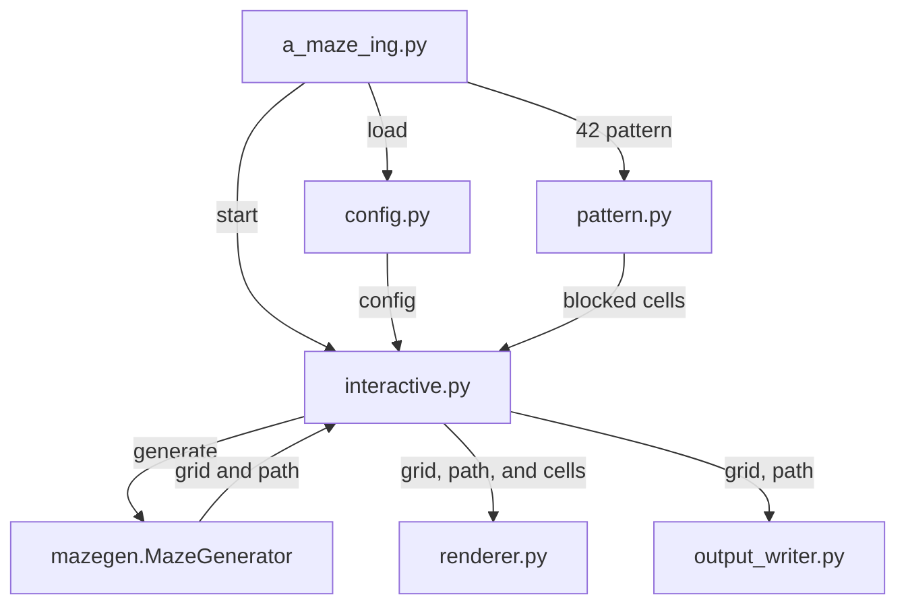

*This project has been created as part of the 42 curriculum by tkern, jhauck.*

# A-Maze-ing

## Description

A-Maze-ing is a maze generator written in Python. It reads a plain-text
configuration file, generates a random maze of the requested size, solves it,
writes the result to a file in a hexadecimal wall format, and displays the maze
in the terminal in an interactive, colored ASCII view.

The generated maze always satisfies a fixed set of structural rules: every
non-blocked cell is reachable from every other one, the outer border is fully
closed, neighbouring cells always agree about the wall between them, no open
area is ever wider than two cells, and a visible **42** is drawn into the maze
using fully closed cells. When `PERFECT=True`, the maze is a *perfect* maze:
exactly one path exists between any two cells.

The generation logic itself lives in a standalone, reusable package called
`mazegen`, which is published at the repository root as an installable wheel
and source archive.

### Feature Overview

- Maze generation with a configurable size, entry, exit and seed.
- Perfect mazes (spanning tree) and imperfect mazes with extra loops.
- A "42" pattern drawn with fully closed cells, automatically centered.
- Shortest entry-to-exit path computed with a breadth-first search.
- Subject-compliant hexadecimal output file.
- Interactive colored terminal renderer.
- Reproducible sessions through an optional seed.

### Architecture



| File | Responsibility |
| --- | --- |
| `a_maze_ing.py` | Entry point: argument handling and top-level error reporting. |
| `config.py` | Reads and validates the configuration file. |
| `pattern.py` | Builds the closed-cell `42` pattern and checks that it fits. |
| `interactive.py` | Runs the interactive session and the regeneration loop. |
| `renderer.py` | Draws the colored ASCII maze. |
| `output_writer.py` | Writes the subject's hexadecimal output file. |
| `mazegen/` | **Reusable package**: generation and shortest-path solving. |

#### Data Flow

1. `a_maze_ing.py` loads and validates the configuration through `config.py`.
2. It creates the closed-cell `42` pattern through `pattern.py`. If the pattern
   does not fit, an error is printed and generation continues without it.
3. It passes the configuration and pattern cells into `interactive.py`.
4. `interactive.py` creates a `MazeGenerator`, which returns the wall grid and
   the shortest entry-to-exit path.
5. The maze is written to `OUTPUT_FILE` by `output_writer.py`.
6. `renderer.py` draws the colored terminal maze, and the session waits for the
   next command.

## Instructions

### Requirements

- Python 3.10 or later.
- [`uv`](https://docs.astral.sh/uv/) for the Makefile targets. Everything can
  also be run with a plain `venv` and `pip`.

### Running the Application

```bash
make install   # create the virtual environment and install dependencies
make run       # run with the default config.txt
```

`make run` uses `config.txt` by default. To use a different configuration file:

```bash
make run CONFIG=my_config.txt
```

Without the Makefile, the program is started exactly as the subject requires:

```bash
python3 a_maze_ing.py config.txt
```

### Makefile Targets

| Target | Description |
| --- | --- |
| `install` | Install project dependencies with `uv sync`. |
| `run` | Run the application with `$(CONFIG)` (default `config.txt`). |
| `debug` | Run the application under the `pdb` debugger. |
| `clean` | Remove caches, build artifacts and the virtual environment. |
| `lint` | Run `flake8` and `mypy` with the flags required by the subject. |
| `lint-strict` | Run `flake8` and `mypy --strict`. |
| `test` | Run the unit test suite. |
| `mazegen-release` | Rebuild the `mazegen` wheel and source archive. |

### Interactive Controls

Once the maze is displayed, the following keys are available:

| Key | Action |
| --- | --- |
| `r` | Re-generate a new maze and display it. |
| `p` | Show or hide the shortest path from entry to exit. |
| `c` | Cycle through the maze wall colours. |
| `q` | Quit. |

`r` always builds a genuinely new maze, whether or not a seed is configured.
`SEED` seeds the **session**, not a single maze: each maze draws its own seed
from that session stream, so two runs with the same `SEED` produce the same
first maze, the same second maze after one `r`, and so on. The header line
shows the session seed and the number of the maze currently on screen, so a
maze can always be found again.

### Display Legend

| Symbol | Meaning |
| --- | --- |
| `E` (green) | Entry cell |
| `X` (red) | Exit cell |
| `.` (cyan) | Shortest path |
| `###` (magenta) | Closed cells forming the `42` pattern |

## Configuration File Format

The configuration file contains one `KEY=VALUE` pair per line.

- Lines starting with `#` are comments and are ignored.
- Blank lines are ignored.
- Whitespace around keys and values is ignored.
- Key names are case-insensitive.
- An unknown key, a duplicate key or a line without `=` is an error.

Every error names the file and the line that caused it, for example:
`config.txt:3: ENTRY 99,99 is outside the maze (x must be < 20, y must be < 15)`.

### Mandatory Keys

| Key | Description | Accepted values | Example |
| --- | --- | --- | --- |
| `WIDTH` | Maze width in cells | Integer from 1 to 1000 | `WIDTH=20` |
| `HEIGHT` | Maze height in cells | Integer from 1 to 1000 | `HEIGHT=15` |
| `ENTRY` | Entry coordinates `x,y` | Inside the maze | `ENTRY=0,0` |
| `EXIT` | Exit coordinates `x,y` | Inside the maze, different from `ENTRY` | `EXIT=19,14` |
| `OUTPUT_FILE` | Output filename | Non-empty, not the config file itself | `OUTPUT_FILE=maze.txt` |
| `PERFECT` | Perfect maze? | `True` or `False`, case-insensitive | `PERFECT=True` |

### Optional Keys

| Key | Description | Accepted values | Example |
| --- | --- | --- | --- |
| `SEED` | Seeds the session, making the whole sequence of mazes reproducible | Any integer or text; unset means a random session | `SEED=42` |
| `ALGORITHM` | Generation algorithm | `DFS` (default) | `ALGORITHM=DFS` |

Coordinates are `(x, y)` with `x` the column and `y` the row. `(0, 0)` is the
top-left cell. Numbers must be written with plain ASCII digits: `+5`, `-5` and
`1_000` are rejected on purpose.

### Complete Example

```ini
# A-Maze-ing default configuration.
# One KEY=VALUE pair per line; lines starting with '#' are ignored.

# --- Mandatory keys ---
WIDTH=20
HEIGHT=15
ENTRY=0,0
EXIT=19,14
OUTPUT_FILE=maze.txt
PERFECT=True

# --- Optional keys ---
# SEED seeds the whole session, not a single maze: [r]egenerate always builds
# a new maze, but the sequence of mazes is identical on every run with the
# same seed. Comment it out for a session that is different every time.
SEED=42

# ALGORITHM selects the generation algorithm (supported: DFS).
ALGORITHM=DFS
```

## Output File Format

The maze is written to `OUTPUT_FILE` using one hexadecimal digit per cell, one
row per line. Each digit is a bitmask of the **closed** walls of that cell:

| Bit | Value | Direction |
| --- | --- | --- |
| 0 (LSB) | 1 | North |
| 1 | 2 | East |
| 2 | 4 | South |
| 3 | 8 | West |

A bit set to `1` means the wall is closed, `0` means it is open. For example,
`3` (binary `0011`) has closed north and east walls, so it is open to the south
and west. `F` (binary `1111`) is a fully closed cell, as used by the `42`
pattern.

After the grid, an empty line is followed by three lines: the entry
coordinates, the exit coordinates, and the shortest valid path from entry to
exit written with the letters `N`, `E`, `S` and `W`. Every line ends with `\n`.

```text
B953D511791393D13D53
C6BC396E96AC6C56A952
...
C545545456C54555545444556

0,0
19,14
SENEESESSWSWSWSWSSSESEENESENENESSEENNNNNNEEENESESSWSEE
```

## Maze Generation Algorithm

### The Algorithm We Chose

Maze generation uses an **iterative randomized depth-first search**, also known
as the **recursive backtracker**, implemented with an explicit stack in
`MazeGenerator.generate`:

1. Start from the first cell that is not part of the `42` pattern.
2. From the cell on top of the stack, collect all neighbours that are in
   bounds, not blocked, and not yet visited.
3. If there is at least one, pick one at random, open the wall between the two
   cells, mark it visited and push it onto the stack.
4. If there is none, pop the stack and backtrack.
5. Repeat until the stack is empty.

Because every cell is opened exactly once, from exactly one neighbour, the
result is a spanning tree over all non-blocked cells. A spanning tree contains
no cycle, which means there is **exactly one path** between any two cells — the
definition of a perfect maze. Connectivity is verified afterwards: if the `42`
pattern were to cut the grid into separate regions, generation fails with a
clear error instead of producing an invalid maze.

When `PERFECT=False`, `_add_extra_passages` opens roughly one extra passage per
ten cells, chosen at random from the still-closed walls. Each candidate is
opened, tested, and reverted again if it would complete a fully open 3-by-3
area. This keeps the subject's rule that corridors may never be wider than two
cells, while creating loops and multiple possible routes.

The shortest path is computed separately by `MazeGenerator.solution_path`,
using a **breadth-first search** from entry to exit. BFS explores the maze in
order of increasing distance, so the first time it reaches the exit it has
found a shortest route; the path is then reconstructed backwards through a
`came_from` map and returned as a string of `N`/`E`/`S`/`W` letters.

### Why We Chose It

- **It gives perfect mazes for free.** A spanning tree is exactly what
  `PERFECT=True` requires, so no extra work or post-processing is needed to
  guarantee a unique path.
- **The mazes look good.** Depth-first search follows one corridor as far as it
  can before backtracking, which produces long, winding passages and relatively
  few short dead ends. Algorithms such as Prim's or Kruskal's tend to produce
  bushier mazes with many short branches, which are visually busier and easier
  to solve by eye.
- **It handles the `42` pattern naturally.** The blocked cells are simply
  treated as non-traversable, so the same code generates around an arbitrary
  set of closed cells without a special case.
- **It never blows the stack.** We use an explicit list instead of recursion,
  so even the maximum supported size of 1000x1000 cells generates without
  hitting Python's recursion limit.
- **It is linear.** Both time and memory grow as O(width x height), and the
  implementation stays short enough to explain and test.

## Reusable Code

The whole generation and solving logic is packaged as `mazegen`, a standalone
package that does not import anything from the application. It is the only part
of the repository meant to be reused in a later project.

| Module | Contents |
| --- | --- |
| `mazegen.generator` | The `MazeGenerator` class and the `Grid` type alias. |
| `mazegen.constants` | The `NORTH`, `EAST`, `SOUTH`, `WEST` and `ALL_WALLS` flags. |

The application modules (`config.py`, `pattern.py`, `renderer.py`,
`output_writer.py`, `interactive.py`) sit on top of it and are deliberately
kept out of the package: the pattern, the terminal renderer and the output
format are specific to this subject, while maze generation is not.

### Building the Package

From the repository root:

```bash
make mazegen-release
```

or directly:

```bash
uv build --out-dir .
```

Both produce the required artifacts at the repository root:

```text
mazegen-0.1.0-py3-none-any.whl
mazegen-0.1.0.tar.gz
```

The build needs only `pyproject.toml` and the `mazegen/` sources, both of which
are in the repository, so the package can be rebuilt from scratch at any time.

### Installing and Using the Package

Install the generated wheel in any Python 3.10+ environment:

```bash
python3 -m pip install mazegen-0.1.0-py3-none-any.whl
```

#### Basic Example

```python
from mazegen import MazeGenerator

generator = MazeGenerator(20, 15)
grid = generator.generate()
path = generator.solution_path((0, 0), (19, 14))
```

#### Custom Parameters

```python
generator = MazeGenerator(
    width=20,
    height=15,
    seed=42,                      # int, str or None; None picks a random seed
    perfect=True,                 # False adds extra passages and loops
    blocked_cells={(5, 5), (5, 6)},  # cells that stay fully closed
)
```

| Parameter | Type | Default | Meaning |
| --- | --- | --- | --- |
| `width` | `int` | required | Number of columns; must be positive. |
| `height` | `int` | required | Number of rows; must be positive. |
| `seed` | `int \| str \| None` | `None` | Seed for reproducible mazes. |
| `perfect` | `bool` | `True` | Keep the maze a spanning tree. |
| `blocked_cells` | `Iterable[tuple[int, int]]` | `None` | Fully closed, unreachable cells. |

#### Accessing the Structure and the Solution

`generate()` returns the wall grid and also stores it in `generator.grid`. The
grid is indexed as `grid[y][x]`, and each cell is a bitmask of its closed
walls:

```python
from mazegen import EAST, NORTH, SOUTH, WEST

cell = grid[0][0]
print(bool(cell & NORTH))   # True when the north wall is closed
print(bool(cell & EAST))    # NORTH=1, EAST=2, SOUTH=4, WEST=8
```

`solution_path(entry, exit_)` returns the shortest route between two cells as a
string of `N`, `E`, `S` and `W` letters:

```python
path = generator.solution_path((0, 0), (19, 14))
print(len(path), "steps:", path)
```

Both methods raise `ValueError` on invalid input — unusable dimensions, blocked
cells used as entry or exit, a solution requested before `generate()`, or a
pattern that splits the maze into unreachable regions.

### Verifying the Package in a Clean Environment

To prove that the application works with the *installed* package rather than
the local sources, create a temporary copy of the application files without the
local `mazegen/` folder:

```bash
printf '\n[1/4] Locating the generated wheel...\n'
repository_dir="$PWD"
wheel="$PWD/mazegen-0.1.0-py3-none-any.whl"
evaluation_dir="$(mktemp -d "$PWD/mazegen-evaluation.XXXXXX")"

printf '[2/4] Copying application files to %s...\n' "$evaluation_dir"
cp a_maze_ing.py config.py interactive.py output_writer.py pattern.py renderer.py \
    config.txt \
    "$evaluation_dir"

cd "$evaluation_dir"
printf '[3/4] Creating a clean virtual environment and installing mazegen...\n'
python3 -m venv .venv
.venv/bin/python -m pip install "$wheel"

printf '[4/4] Running the application with the installed package...\n\n'
.venv/bin/python a_maze_ing.py config.txt

printf '\nCleaning up the temporary evaluation directory...\n'
cd "$repository_dir"
rm -rf "$evaluation_dir"
```

The temporary directory has no local `mazegen/` folder, so this run can only
import the wheel installed in its virtual environment. It is removed
immediately after the application exits; enter `q` to quit.

## Testing

The repository contains a unit test suite built on `unittest` (not part of the
graded deliverable):

```bash
make test
```

It covers configuration parsing and validation, the `42` pattern, generator
invariants, the output format, and the application's error handling.

## Team and Project Management

### Roles

| **jhauck** | Maze generation core: the DFS generator, the `mazegen` package layout, the `42` pattern, the terminal renderer and the interactive session. Project architecture and the refactoring into a reusable package. |
| **tkern** | Shortest-path solver, the hexadecimal output writer, the configuration loader, and the `uv`-based Makefile and tooling. |

Both of us reviewed each other's work through pull requests on GitHub, and the
final hardening pass (error handling, tests, linting) was done together.

### Planning and How It Evolved

| Phase | What happened |
| --- | --- |
| **Day 1 (18 Sep)** | Split the problem in two: generation on one side, solving and output on the other. Both parts were started in parallel and merged through pull requests. A first working DFS maze with ASCII output existed at the end of the day. |
| **Day 2 (19 Sep)** | The reusability requirement forced a restructure. Generation and solving were pulled out of the application into the standalone `mazegen` package, and the separate `solver.py` was removed after its logic was ported into `MazeGenerator`. |
| **Day 3 (20 Sep)** | The interactive layer: regeneration, path toggle, colour cycling, plus the `42` pattern and the coloured renderer. Documentation of the build and the package API. |
| **Day 4 (21 Sep)** | Checking the code together, adding error message for maze size/42/entry/exit, impoving the genation algorythm for imperfect mazes. Makefile linting strict added.  
| **Day 5 (22 Sep)** | Hardening: pattern validation, terminal I/O failures, seed and regeneration behaviour, the unit test suite, and the final README. |

The plan we started with underestimated the reusability requirement. We first
wrote the generator as part of the application and only then extracted it,
which cost most of day 2. Starting from the package boundary would have been
faster.

### What Worked Well

- Splitting generation from solving let both of us work without blocking each
  other on day 1.
- Moving everything into `mazegen` early enough that the application code could
  be written against the final API.
- Keeping `mypy --strict` and `flake8` green from the start, instead of fixing
  type and style problems at the end.
- Validating the generator against the subject's structural rules
  (connectivity, wall coherence, closed borders, no 3-by-3 open areas, unique
  path) rather than only checking that it looked right on screen.

### What Could Be Improved

- We should have designed the reusable package boundary first. Extracting it
  afterwards meant rewriting code that already worked.
- Early on, the same functionality was written twice in parallel because our
  split was not precise enough; the duplicate solver had to be thrown away.
- Only one generation algorithm is supported. The `ALGORITHM` key exists and is
  validated, but `DFS` is currently the only accepted value.

### Tools We Used

| Tool | Purpose |
| --- | --- |
| `uv` | Dependency management, virtual environment and package building. |
| `flake8` | Style checking against the 42 coding standard. |
| `mypy` | Static type checking, in both the required and `--strict` modes. |
| `unittest` | Unit tests. |
| `git` / GitHub | Version control, branches and pull-request reviews. |
| `setuptools` / `build` | Building the `mazegen` wheel and source archive. |

## Resources

### Maze Generation and Graph Theory

- [Maze generation algorithm — Wikipedia](https://en.wikipedia.org/wiki/Maze_generation_algorithm)
  — overview of the recursive backtracker, Prim's and Kruskal's algorithms.
- [Maze solving algorithm — Wikipedia](https://en.wikipedia.org/wiki/Maze-solving_algorithm)
  — the family of algorithms our BFS solver belongs to.
- [Spanning tree — Wikipedia](https://en.wikipedia.org/wiki/Spanning_tree)
  — why an acyclic spanning structure yields exactly one path between cells.
- [Breadth-first search — Wikipedia](https://en.wikipedia.org/wiki/Breadth-first_search)
  — the shortest-path search used by `solution_path`.
- Jamis Buck, [*Maze Generation: Recursive Backtracking*](https://weblog.jamisbuck.org/2010/12/27/maze-generation-recursive-backtracking)
  — a well-known walkthrough of the algorithm we implemented, with animations.
- Walter D. Pullen, [*Think Labyrinth: Maze Algorithms*](https://www.astrolog.org/labyrnth/algrithm.htm)
  — a comparison of maze algorithms and the properties of the mazes they make.

### Use of AI

AI assistance was used for the following tasks:

- **Reviewing against the subject.** Going through the subject requirement by
  requirement and cross-checking them against the implementation.
- **Test and validation support.** Writing an independent validator that
  re-checks the structural rules of generated mazes (wall coherence, closed
  borders, connectivity, absence of 3-by-3 open areas, uniqueness of the path
  in perfect mazes, and that the returned path really is a shortest one), and
  extending the unit test suite.
- **Refactoring suggestions.** Discussing how to split the reusable `mazegen`
  package from the application code.

AI was **not** used to generate the maze generation or solving logic itself.
Every algorithmic decision — the choice of depth-first search, the wall
bitmask representation, the `42` pattern encoding and the extra-passage rule
for imperfect mazes — was made and implemented by us, and all AI-generated
text and test code was reviewed and adapted before being committed.
