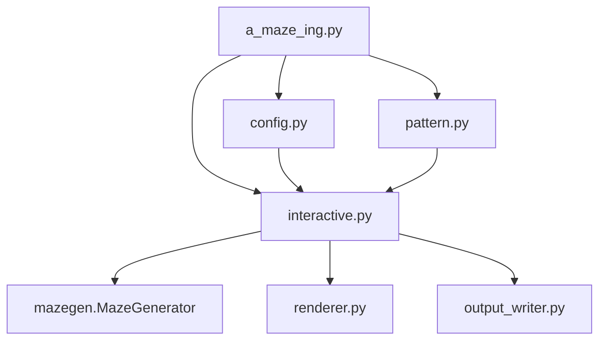

*This project has been created as part of the 42 curriculum by tkern, jhauck.*

# A-Maze-ing

## Description

A-Maze-ing is a Python maze generator. It reads a configuration file, creates
and solves a maze, writes it in the subject's hexadecimal wall format, and
displays it in an interactive coloured ASCII terminal interface.

All non-pattern cells are connected, the outer borders are closed, and shared
walls are coherent. `PERFECT=True` produces a spanning-tree maze with exactly
one path between any two active cells. The visual maze includes a centred `42`
made of fully closed cells when that placement is valid. The reusable generation
and shortest-path code is distributed as the root-level `mazegen` package.

### Features

- Configurable dimensions, entry, exit, perfection, seed, and output path.
- Iterative randomized DFS generation and breadth-first shortest-path solving.
- Closed-cell `42` pattern, coloured ASCII display, and hexadecimal output.
- Regeneration, path visibility, wall-colour cycling, and clean exit.
- Reproducible generation with an optional seed.

### Architecture



`a_maze_ing.py` validates command-line use and reports top-level errors.
`config.py` parses the config; `pattern.py` validates the `42` placement;
`interactive.py` coordinates generation, output, and controls; `renderer.py`
draws the maze; `output_writer.py` serializes it. `mazegen/` is the standalone
reusable package.

## Instructions

### Requirements

- Python 3.10 or later.
- [`uv`](https://docs.astral.sh/uv/) for the provided Makefile targets.

### Run

```bash
make install
make run
```

The exact required command, without Make, is:

```bash
python3 a_maze_ing.py config.txt
```

Use another configuration file with `make run CONFIG=my_config.txt`.

| Target | Purpose |
| --- | --- |
| `install` | Create the environment and install dependencies with `uv sync`. |
| `run` | Start the application using `$(CONFIG)` (`config.txt` by default). |
| `debug` | Start under `pdb`. |
| `clean` | Remove caches, build artifacts, `maze.txt`, and `.venv`. |
| `lint` | Run subject-required `flake8` and `mypy` checks. |
| `lint-strict` | Run `flake8` and `mypy --strict`. |
| `test` | Run the `unittest` suite. |
| `mazegen-release` | Build the root-level wheel and source archive. |

### Interactive Controls

| Key | Action |
| --- | --- |
| `r` | Regenerate the maze. |
| `p` | Show or hide the shortest path. |
| `c` | Cycle wall colours. |
| `q` | Quit. |

With `SEED` configured, regeneration deliberately produces the same maze: the
same seed is used again to demonstrate reproducibility. Without `SEED`, every
regeneration selects a fresh random seed and displays a new maze.

`E` marks the green entry, `X` the red exit, `.` the cyan shortest path, and
magenta `###` cells form the `42` pattern.

## Configuration File Format

The file has one `KEY=VALUE` pair per line. Blank lines and lines beginning
with `#` are ignored; whitespace around keys and values is ignored; keys are
case-insensitive. Unknown or duplicate keys, and lines without `=`, are errors.
Errors name the file and, where applicable, their line.

| Mandatory key | Meaning | Accepted value | Example |
| --- | --- | --- | --- |
| `WIDTH` | Width in cells | Integer from 1 to 1000 | `WIDTH=20` |
| `HEIGHT` | Height in cells | Integer from 1 to 1000 | `HEIGHT=15` |
| `ENTRY` | Entry coordinate | In-bounds `x,y` | `ENTRY=0,0` |
| `EXIT` | Exit coordinate | In-bounds `x,y`, different from entry | `EXIT=19,14` |
| `OUTPUT_FILE` | Generated maze path | Non-empty; not the config itself | `OUTPUT_FILE=maze.txt` |
| `PERFECT` | Perfect-maze mode | `True` or `False` | `PERFECT=True` |

| Optional key | Meaning | Accepted value | Example |
| --- | --- | --- | --- |
| `SEED` | Seed for reproducible generation | Non-empty unsigned integer or text | `SEED=42` |
| `ALGORITHM` | Generation algorithm | `DFS` (default) | `ALGORITHM=DFS` |

Coordinates use `(x, y)`, where `(0, 0)` is the top-left cell. Numeric
dimensions and coordinates use ASCII digits only; forms such as `+5`, `-5`, and
`1_000` are rejected.

```ini
# Mandatory keys
WIDTH=20
HEIGHT=15
ENTRY=0,0
EXIT=19,14
OUTPUT_FILE=maze.txt
PERFECT=True

# Optional keys
# A configured seed makes every regeneration reproduce this maze.
SEED=42
ALGORITHM=DFS
```

If the centred `42` cannot be placed, because the maze is too small, the
pattern would cover the entry or exit, or it would disconnect part of the maze,
the program prints an error explaining why and continues without it.

## Output File Format

Each maze row contains one uppercase hexadecimal digit per cell. Bits represent
**closed** walls: North=`1`, East=`2`, South=`4`, West=`8`. Thus `3` has north
and east walls closed, while `F` is a fully closed `42`-pattern cell.

After the grid and an empty line come the entry coordinates, exit coordinates,
and shortest path on three separate lines. The path contains only `N`, `E`,
`S`, and `W`; every line ends in `\n`.

## Maze Generation Algorithm

### Chosen Algorithm

`MazeGenerator.generate()` uses iterative randomized depth-first search with an
explicit stack. It starts at an active cell, randomly opens a wall to an
unvisited active neighbour, and backtracks when no such neighbour remains. Each
new active cell is connected by exactly one newly opened passage, producing a
spanning tree. Therefore a perfect maze has one unique path between active
cells.

When `PERFECT=False`, the generator opens a limited number of additional
passages. Each candidate is reverted if it would form a completely open 3×3
area, preserving the subject's corridor-width rule. `solution_path()` uses
breadth-first search, so its reconstructed `N`/`E`/`S`/`W` route is shortest.

### Why DFS

DFS naturally creates a perfect maze, handles the closed `42` cells as blocked
cells without special generation logic, produces long winding corridors, has
linear time and memory complexity, and uses an explicit stack rather than
Python recursion.

## Reusable Code: `mazegen`

`mazegen` is independent of the application and contains `MazeGenerator`, the
`Grid` type, and wall constants. Its own documentation,
[`mazegen/README.md`](mazegen/README.md), is shipped inside the package. It can be built from the tracked
`pyproject.toml` and `mazegen/` source:

```bash
make mazegen-release
```

This creates `mazegen-0.1.0-py3-none-any.whl` and `mazegen-0.1.0.tar.gz` in the
repository root. Install and use the wheel in any Python 3.10+ environment:

```bash
python3 -m pip install mazegen-0.1.0-py3-none-any.whl
```

```python
from mazegen import MazeGenerator

generator = MazeGenerator(20, 15, seed=42, perfect=True)
grid = generator.generate()                 # grid[y][x], closed-wall bitmasks
path = generator.solution_path((0, 0), (19, 14))  # shortest N/E/S/W route
```

Custom parameters include `width`, `height`, `seed` (`int`, `str`, or `None`),
`perfect`, and `blocked_cells`, an iterable of fully closed coordinates.
Construction rejects invalid dimensions, out-of-bounds blocked cells, and a
fully blocked maze. `generate()` rejects blocked cells that divide active cells;
`solution_path()` rejects pre-generation calls and invalid or blocked endpoints.

### Clean Installation Check

```bash
make mazegen-release
temporary_dir="$(mktemp -d)"
python3 -m venv "$temporary_dir/venv"
"$temporary_dir/venv/bin/pip" install mazegen-0.1.0-py3-none-any.whl
"$temporary_dir/venv/bin/python" -c \
  "from mazegen import MazeGenerator; print(MazeGenerator(3, 2, seed=42).generate())"
rm -rf "$temporary_dir"
```

This imports and uses the wheel outside the source tree.

## Team and Project Management

### Roles

| Member | Responsibilities |
| --- | --- |
| **jhauck** | DFS generator, `mazegen` package layout, `42` pattern, terminal renderer, interactive session, and reusable-package architecture. |
| **tkern** | Shortest-path solver, output writer, config loader, and `uv` Makefile/tooling. |

Both team members reviewed pull requests and completed the final error-handling,
testing, and linting pass together.

### Planning and Retrospective

We initially split generation from solving and output so both parts could be
developed in parallel. The first working DFS maze and ASCII output were then
merged. Next, the reusability requirement led us to extract generation and
solving into `mazegen`. We subsequently added the interactive controls, `42`
pattern, colouring, validation, and package build workflow.

The parallel split worked well, as did keeping `flake8` and strict `mypy`
checks green during development. We should have designed the reusable-package
boundary first: extracting it after initial application work required a larger
refactor. Only DFS is currently supported; multiple algorithms remain a
possible extension.

Tools used: `uv`, `flake8`, `mypy`, `unittest`, `git`/GitHub, `setuptools`, and
the Python `build` tooling.

## Resources

- [Maze generation algorithm — Wikipedia](https://en.wikipedia.org/wiki/Maze_generation_algorithm)
- [Breadth-first search — Wikipedia](https://en.wikipedia.org/wiki/Breadth-first_search)
- [Spanning tree — Wikipedia](https://en.wikipedia.org/wiki/Spanning_tree)
- [Jamis Buck: Maze Generation: Recursive Backtracking](https://weblog.jamisbuck.org/2010/12/27/maze-generation-recursive-backtracking)
- [Think Labyrinth: Maze Algorithms](https://www.astrolog.org/labyrnth/algrithm.htm)

### Use of AI

AI assistance was used to review the project against the subject, discuss test
coverage and validation strategies, and suggest package/application separation.
It was not used to generate the maze-generation or solving logic. All
AI-assisted material was reviewed, understood, and adapted by the team before
being included.
