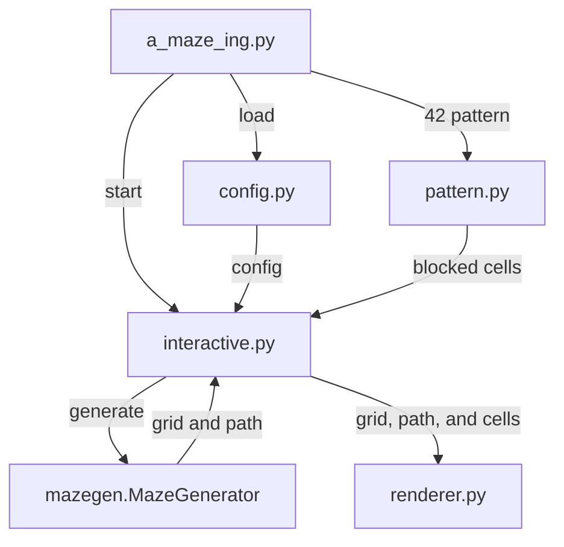

# A-Maze-ing Architecture

## Data Flow

1. `a_maze_ing.py` loads and validates the configuration through `config.py`.
2. It creates the closed-cell `42` pattern through `pattern.py`.
3. It passes the configuration and pattern cells into `interactive.py`.
4. `interactive.py` creates `MazeGenerator`, which returns the wall grid and
   the shortest entry-to-exit path.
5. `interactive.py` passes the grid, path, entry/exit, and pattern cells to
   `renderer.py`.
6. `renderer.py` draws the colored terminal maze and accepts state supplied by
   the interactive session.
