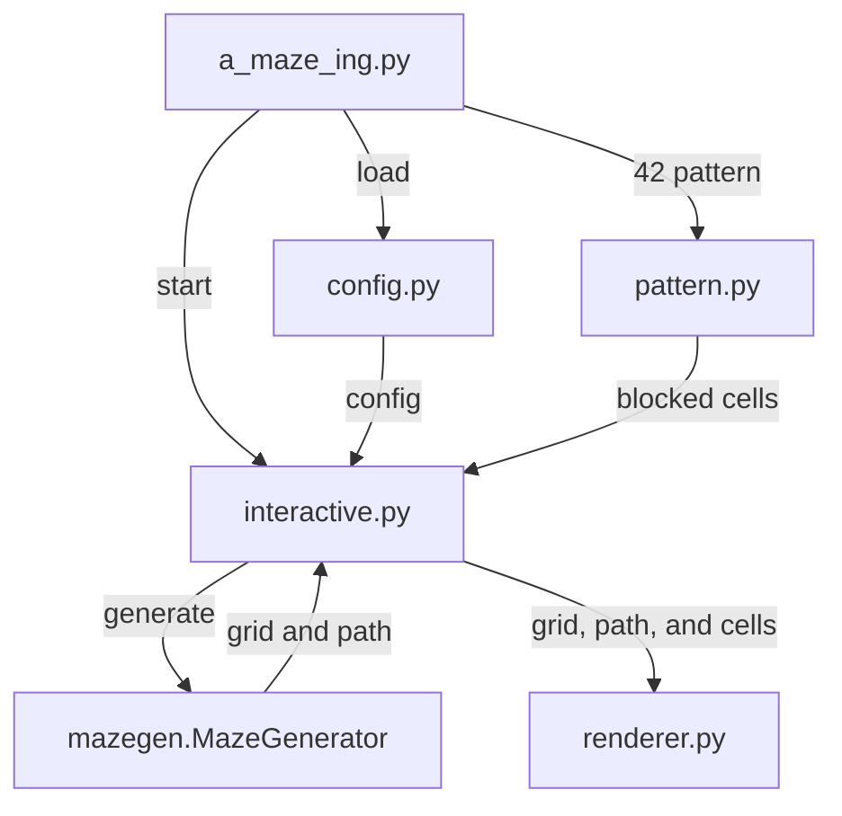

# A-Maze-ing Architecture



## Data Flow

1. `a_maze_ing.py` loads and validates the configuration through `config.py`.
2. It creates the closed-cell `42` pattern through `pattern.py`.
3. It passes the configuration and pattern cells into `interactive.py`.
4. `interactive.py` creates `MazeGenerator`, which returns the wall grid and
   the shortest entry-to-exit path.
5. `interactive.py` passes the grid, path, entry/exit, and pattern cells to
   `renderer.py`.
6. `renderer.py` draws the colored terminal maze and accepts state supplied by
   the interactive session.

## `mazegen` Package

### Manual Build

From the repository root, build the reusable package directly with `uv`:

```bash
uv build --out-dir .
```

This creates the required artifacts at the repository root:

```text
mazegen-0.1.0-py3-none-any.whl
mazegen-0.1.0.tar.gz
```

The equivalent convenience command is:

```bash
make mazegen-release
```

### Using the Package

Install the generated wheel in any Python 3.10+ environment:

```bash
python3 -m pip install mazegen-0.1.0-py3-none-any.whl
```

Then import and use `MazeGenerator`:

```python
from mazegen import MazeGenerator

generator = MazeGenerator(20, 15, seed=42, perfect=True)
grid = generator.generate()
path = generator.solution_path((0, 0), (19, 14))
```

`grid` is stored as `grid[y][x]`; each cell is a wall bitmask using North=1,
East=2, South=4, and West=8. `path` is the shortest route expressed as
`N`, `E`, `S`, and `W` letters.

### Clean-Install Evaluation

To prove that the application works with the installed package, create a
temporary copy of the application files without the local `mazegen/` source:

```bash
printf '\n[1/4] Locating the generated wheel...\n'
repository_dir="$PWD"
wheel="$PWD/mazegen-0.1.0-py3-none-any.whl"
evaluation_dir="$(mktemp -d "$PWD/mazegen-evaluation.XXXXXX")"

printf '[2/4] Copying application files to %s...\n' "$evaluation_dir"
cp a_maze_ing.py config.py interactive.py output_writer.py pattern.py renderer.py \
    config.txt \
    "$evaluation_dir"

cd "$evaluation_dir"
printf '[3/4] Creating a clean virtual environment and installing mazegen...\n'
python3 -m venv .venv
.venv/bin/python -m pip install "$wheel"

printf '[4/4] Running the application with the installed package...\n\n'
.venv/bin/python a_maze_ing.py config.txt

printf '\nCleaning up the temporary evaluation directory...\n'
cd "$repository_dir"
rm -rf "$evaluation_dir"
```

The temporary directory is created beside the project files and has no local
`mazegen/` folder, so this run can only import the wheel installed in its
virtual environment. It is removed immediately after the application exits;
enter `q` to exit the interactive application.
